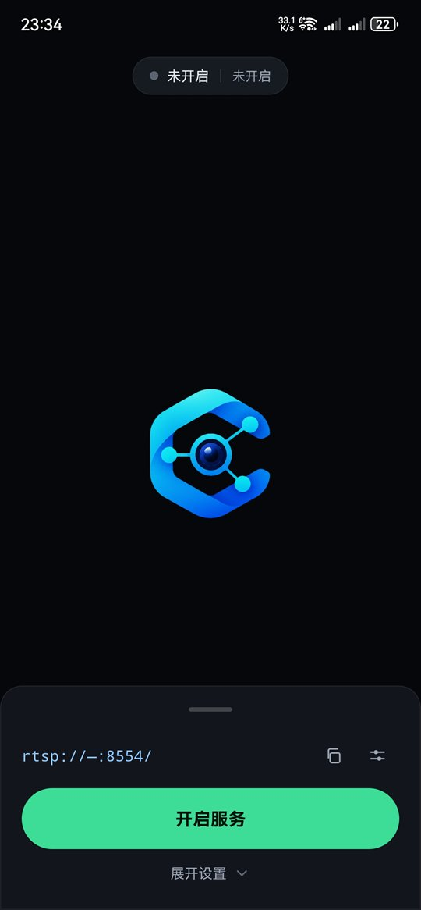
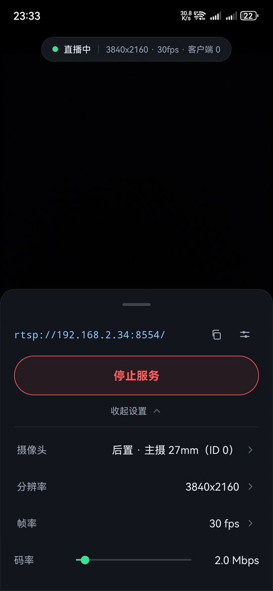
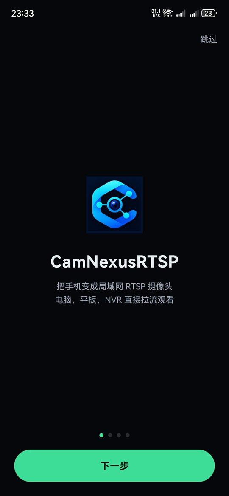

# CamNexusRTSP

**把手机变成局域网里的 RTSP 摄像头。** 打开应用、点一下开始，同一网络下的电脑、平板、
录像机就能像看普通监控一样拉取实时画面。

[English](README.en.md) | 简体中文

---

## 它解决什么问题

手机摄像头画质远好于普通家用摄像头，但系统没有提供把画面"广播"出去的标准接口。
CamNexusRTSP 在手机本地跑一个 RTSP 服务，把摄像头画面编码后实时推送出去，
任何支持 RTSP 的播放器都能直接观看，不需要电脑中转、不上传云端。

## 界面

| 主界面 | 运行中 · 展开设置 | 新手引导 |
|:---:|:---:|:---:|
|  |  |  |

## 功能
### 画面

- 全屏实时预览，顶部状态条显示分辨率、帧率、在线客户端数
- 摄像头、分辨率、帧率、码率均可随时切换，修改后约 1 秒生效
- 支持 H.264 与 H.265；优先使用手机硬件编码器，也可强制软件编码
- 多摄手机自动识别镜头并标注超广角 / 主摄 / 长焦，重复的逻辑相机自动合并

### 网络与访问

- 标准 RTSP 协议，VLC、ffplay、PotPlayer、多数 NVR 直接可用
- 支持多客户端同时观看
- 可选访问验证（用户名 + 密码），默认开启
- 端口可改，默认 8554

### 长时间运行

- 前台服务运行，切到后台或锁屏后继续推流
- 持有 Wi-Fi 高性能锁，避免息屏后断流
- 省电模式：无人观看一段时间后自动降到低分辨率
- 提供后台保活入口，可根据手机品牌跳转到对应系统设置

### 上手

- 四页新手引导，讲解界面与功能，并检测相机、麦克风、通知权限
- 设备检测页读取本机编码器、相机与网络能力，给出推荐参数并可一键应用

## 快速开始

1. 从仓库的 **Releases** 页面下载 APK 并安装
2. 打开应用，点「开启服务」，按提示授予相机与麦克风权限
3. 应用会显示拉流地址，例如 `rtsp://192.168.1.23:8554/`
4. 在同一网络下的设备上播放：

```bash
# ffplay
ffplay -rtsp_transport tcp rtsp://192.168.1.23:8554/

# VLC
vlc rtsp://192.168.1.23:8554/
```

默认账号密码均为 `camnexus`，可在设置中修改。

> **想在电脑上集中看？** 搭配 [CamNexus](https://github.com/oywq00008-cell/CamNexus) 使用——
> 它是 Windows 端的监控中枢，把这台手机加入通道即可多路同屏、按需录像与回放，同样 MIT 开源。

## 设置项

| 设置 | 说明 |
|---|---|
| 编码格式 | H.264 / H.265，取决于播放器支持 |
| 编码器 | 自动 / 硬件 / 软件 |
| 省电模式 | 无人观看后自动降低画质 |
| RTSP 端口 | 1024–65535，默认 8554 |
| 访问验证 | 开关 + 用户名 + 密码 |
| 后台保活 | 查看电池优化状态并跳转系统设置 |
| 设备检测 | 读取硬件能力，给出推荐参数 |

## 系统要求

- Android 5.0（API 21）及以上
- 需要相机权限；语音需要麦克风权限；Android 13 及以上需要通知权限

## 从源码构建

需要 JDK 17 与 Android SDK（compileSdk 37）。

```bash
./gradlew assembleDebug     # 调试包
./gradlew assembleRelease   # 正式包（需自备签名配置）
```

> 国内网络首次运行 `gradlew` 会下载 Gradle 发行包，较慢时可将
> `gradle/wrapper/gradle-wrapper.properties` 中的地址换成腾讯云镜像。

## 许可证

源代码以 [MIT](LICENSE) 协议发布。

运行时依赖 RootEncoder、RTSP-Server、AndroidX，均为 Apache-2.0，
其版权与许可条款见 [THIRD-PARTY-NOTICES.md](THIRD-PARTY-NOTICES.md)。

应用名称与图标不属于 MIT 授权范围，二次发布请自行替换。


